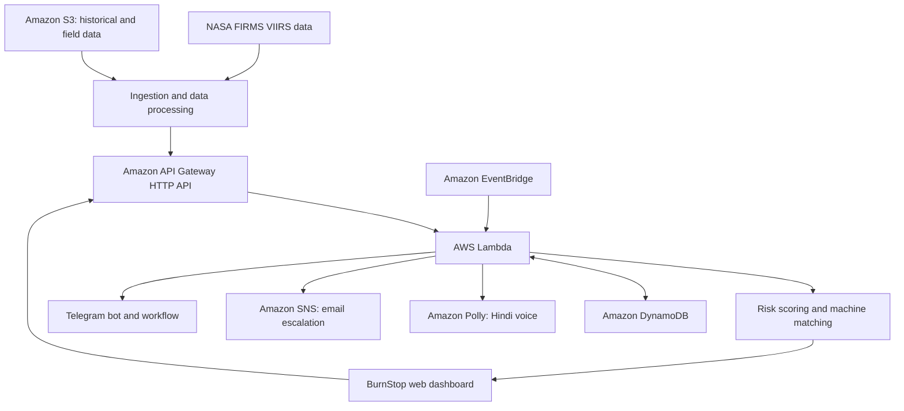

# BurnStop 🌾
### Turning fire intelligence into timely agricultural intervention

**AIR Track · Stubble Burning · Punjab & Haryana, India**

BurnStop is an AWS-powered prototype designed to help reduce stubble burning by connecting satellite-derived fire intelligence with coordinated agricultural intervention.

Detecting fire activity is only one part of the problem. Getting the right agricultural machinery to the right area at the right time requires prioritisation, resource matching, human approval, reliable communication, and follow-up.

BurnStop brings these steps into a single workflow.

**Detect → Prioritise → Propose → Approve → Act → Verify → Escalate**

> The goal isn't just to map burning fields. It's to make timely alternatives easier to coordinate.

**Live demo:** [Open BurnStop](https://rq59g2yxy5.execute-api.ap-south-1.amazonaws.com/)  
**Source code:** [GitHub repository](https://github.com/faiza-tabasum/BurnStop)

---

## The problem

After the paddy harvest, farmers across Punjab and Haryana face a limited window to prepare their fields for the next crop. Crop residue must be managed quickly, and burning remains one of the options used to clear fields.

Alternatives such as Happy Seeder machinery can help farmers manage crop residue without burning it. However, machinery availability alone does not guarantee that an alternative will reach a farmer when it is needed.

Several coordination gaps can stand in the way:

- Identifying which areas need attention first.
- Finding an available machine at a suitable hiring centre.
- Estimating whether the machine can reach the area in time.
- Coordinating approvals and operator availability.
- Confirming whether an intervention was completed.
- Checking subsequent fire detections and escalating cases that need attention.

BurnStop focuses on this operational gap.

It uses satellite-derived fire detections and a transparent risk-ranking approach to help prioritise areas, propose machinery assignments, coordinate the intervention workflow, and check subsequent fire activity.

The project is a prototype for supporting stubble-burning reduction, not a claim that satellite monitoring or machinery allocation alone can eliminate the practice.

## How BurnStop works

| Stage | What happens |
|---|---|
| **Detect** | Ingest satellite-derived active-fire detections from NASA FIRMS. |
| **Prioritise** | Calculate an explainable risk score for geographic cells. |
| **Propose** | Match higher-priority cells with suitable available machinery. |
| **Approve** | Allow an officer to review and approve a proposed assignment. |
| **Act** | Notify the relevant participants, record operator acceptance or decline, and track service completion. |
| **Verify** | Check subsequent fire detections after a reported intervention. |
| **Escalate** | Flag relevant outcomes and notify the officer when further attention is needed. |

The workflow distinguishes between a proposed assignment, an approved assignment, an accepted assignment, and a completed service. These states are not interchangeable, and the dashboard makes their progression visible.

## Risk prioritisation

BurnStop organises the region into geographic cells of approximately 5 km, labelled using their nearest reference town.

Each cell receives a weighted score based on four factors:

- **Recent fire activity:** recent detections in and around the cell.
- **Historical fire activity:** detections from the corresponding period in the previous year.
- **Sowing urgency:** proximity to the configured sowing cut-off.
- **Machinery proximity:** whether intervention resources are available nearby.

The resulting score is used to classify cells as High, Medium, or Low priority.

The scoring method is deliberately transparent and rule-based. It is not a trained machine-learning model, and its weights should not be interpreted as calibrated probabilities of future burning.

The purpose is to provide an explainable starting point for prioritising intervention—not to predict individual field fires with certainty.

## Matching agricultural machinery

Once cells have been prioritised, BurnStop proposes available Happy Seeder machines associated with Custom Hiring Centres (CHCs).

The matching logic considers road distance and estimated travel time, ranks candidate resources, and can present an alternative machine when available.

An officer reviews the proposal before approval. The operator can subsequently accept the assignment or decline it. A declined assignment can trigger reassignment to another candidate.

After service completion, the workflow moves into verification.

This design keeps the decision-making process visible and ensures that the system does not treat a proposed assignment as proof that an intervention took place.

## Architecture

BurnStop uses AWS managed services to connect data ingestion, risk processing, persistent operational state, scheduled execution, and notifications.



*Conceptual architecture. The diagram groups related responsibilities; it does not represent every individual API route or event.*

### AWS services

| Service | Role in BurnStop |
|---|---|
| **AWS Lambda** | Runs backend handlers and application logic for ingestion, risk processing, assignment workflows, and verification. |
| **Amazon API Gateway (HTTP API)** | Exposes the backend through HTTP endpoints used by the web dashboard and supported integrations. |
| **Amazon DynamoDB** | Stores operational records for fields, hiring centres, machines, assignments, and intervention status. |
| **Amazon S3** | Stores field datasets, archived FIRMS data, and demonstration inputs. |
| **Amazon EventBridge** | Supports scheduled backend jobs. |
| **Amazon Polly** | Generates Hindi voice output for supported farmer-facing messages. |
| **Amazon SNS** | Supports email escalation notifications. |
| **AWS SAM and CloudFormation** | Define and deploy the application infrastructure as a stack. |
| **AWS CloudShell** | Provides a browser-based environment for building and deploying the project without requiring a local AWS development setup. |

**Why this architecture?**

The dashboard handles presentation and user interactions, while the backend processes actions and maintains application state. Persistent records allow assignments to progress across multiple stages, and scheduled execution supports time-driven processing independently of someone manually refreshing the dashboard.

AWS managed services also make it possible to prototype the workflow without maintaining a dedicated application server.

### Additional technologies

- **JavaScript, HTML and CSS:** web interface and client-side interactions.
- **Leaflet:** interactive geographic risk map.
- **CARTO and OpenStreetMap:** basemap rendering and geographic context.
- **NASA FIRMS:** satellite-derived active-fire data.
- **Telegram Bot API:** participant messaging and the operator-facing workflow used in the demonstration.
- **Node.js:** local development, testing, data preparation, and backtesting.
- **Amazon Polly:** Hindi audio generation.

Hindi and Punjabi message templates are written manually. Amazon Translate is not used. Polly provides Hindi audio for this prototype; Punjabi voice generation is not currently supported by the implementation.

Amazon Bedrock is not required by the current workflow.

## Data sources and transparency

BurnStop combines real satellite observations with clearly labelled simulated operational records.

| Data | Source | Status |
|---|---|---|
| VIIRS active-fire detections | NASA FIRMS | Real satellite-derived observations |
| Archived fire seasons | NASA FIRMS API | Real historical observations when fetched successfully |
| Field and geographic reference records | Project dataset | Verify provenance in the repository |
| Machines and availability | Generated demonstration records | Simulated |
| Custom Hiring Centres | Generated demonstration records | Simulated |
| Farmers and operator records | Generated demonstration records | Simulated |
| Assignments and intervention outcomes | Demonstration workflow | Simulated operational activity |

No usable public dataset for the project's required machine, hiring-centre, and farmer records was available for this prototype, so these records are simulated and labelled as such in the interface.

The Telegram workflow uses the developer's own chat as a demonstration stand-in for the farmer, operator, and officer roles. It is not a live messaging integration with actual farmers or government officers.

### Interpreting verification results

BurnStop checks subsequent FIRMS detections in the relevant geographic area after an intervention is marked complete.

A subsequent detection can trigger a failed-verification status and escalation. The absence of a detection can produce a different verification outcome.

Neither outcome proves causation:

- A detection does not, by itself, prove that a particular farmer burned a field or that the intervention failed.
- No detection does not prove that burning did not occur or that the intervention prevented it.

Verification is therefore treated as a follow-up signal that helps identify cases requiring attention, rather than definitive evidence of environmental impact.

## Evaluation and backtesting

BurnStop includes a historical backtesting workflow implemented in `scripts/backtest.mjs`.

The backtest evaluates the risk-ranking approach against simpler baselines using a held-out historical season. The evaluation examines whether highly ranked cells have subsequent fire detections, including within a two-day evaluation window.

The comparison includes:

- The BurnStop risk ranking.
- A persistence baseline based on observed fire activity.
- A random-selection baseline.

This comparison helps assess whether the weighted score offers useful prioritisation beyond simpler approaches.

Backtest results should be interpreted in the context of their evaluation period, sample size, data quality, and methodology. Predictive performance on historical detections does not establish that a coordinated intervention will prevent burning.

The `backtest.json` artifact is generated by the evaluation script and displayed in the application when available.

## Running BurnStop locally

You can explore the interface and run the end-to-end self-test without deploying AWS infrastructure.

### Prerequisites

- Node.js 18 or later.
- A terminal or command prompt.

### 1. Generate demonstration data

From the project root:

```bash
node scripts/make-synthetic.mjs /tmp/bs
```

This generates synthetic test data for local demonstration. It is not real fire data and should not be presented as such.

### 2. Run the end-to-end self-test

```bash
FIRES_DIR=/tmp/bs node scripts/test.mjs
```

The test exercises the local workflow using the generated dataset.

### 3. Start the local application

```bash
FIRES_DIR=/tmp/bs node scripts/local.mjs
```

Open the local URL printed by the server. The documented default is:

```text
http://localhost:8080
```

The local demonstration uses the PIN:

```text
1234
```

This is a demonstration credential only. Do not reuse it for a public deployment.

**Data separation:** keep synthetic test files separate from the real historical datasets used for evaluation. Do not copy synthetic fire data into the production or historical data directory and then describe it as NASA FIRMS data.

## Deploying to AWS

The application can be deployed to the AWS Asia Pacific (Mumbai) Region (`ap-south-1`) using AWS CloudShell and AWS SAM.

Deployment requires an AWS account, the required IAM permissions, and a NASA FIRMS API key. Telegram and notification configuration are required for their respective integrations.

### 1. Obtain the required credentials

- **NASA FIRMS:** obtain a MAP_KEY from the [NASA FIRMS API portal](https://firms.modaps.eosdis.nasa.gov/api/).
- **Telegram:** create a bot through [@BotFather](https://t.me/BotFather) and configure the required bot token and chat ID.
- **AWS:** open the AWS Console, select the Mumbai Region, and launch CloudShell.

Treat every token, PIN, and webhook secret as sensitive configuration. Never commit real credentials to the repository.

### 2. Upload and extract the project

Upload the project archive to CloudShell using its file-upload interface, then extract it:

```bash
unzip burnstop.zip
cd burnstop
node -v
sam --version
```

Node.js 18 or later is required. Install AWS SAM CLI in CloudShell if it is not already available.

### 3. Fetch historical FIRMS data

```bash
node scripts/fetch-history.mjs YOUR_FIRMS_KEY
```

This script fetches the configured historical seasons. The resulting files depend on the script's configuration and successful data retrieval.

Run the backtest for the desired evaluation season:

```bash
node scripts/backtest.mjs 2025
```

Review the generated data and results before publishing or using them in a demonstration.

The historical files and backtest output should reflect the actual fetch and evaluation run, not generated synthetic data.

### 4. Build and deploy

Build the SAM application:

```bash
sam build
```

Deploy the stack:

```bash
sam deploy \
  --stack-name burnstop \
  --region ap-south-1 \
  --resolve-s3 \
  --capabilities CAPABILITY_IAM \
  --no-confirm-changeset \
  --parameter-overrides \
    FirmsKey="YOUR_FIRMS_KEY" \
    OfficerPin="YOUR_OFFICER_PIN" \
    OfficerEmail="YOUR_EMAIL" \
    TelegramToken="YOUR_BOT_TOKEN" \
    TelegramChatId="YOUR_CHAT_ID" \
    WebhookSecret="YOUR_WEBHOOK_SECRET"
```

Replace every placeholder with your own configuration. Use a strong officer PIN and webhook secret.

The deployment output includes the application's `AppUrl` and, where configured, the webhook URL.

Avoid sharing terminal output that contains sensitive parameters.

### 5. Confirm email delivery

If the deployment uses an SNS email subscription, check your inbox and complete AWS's subscription-confirmation step. Until the subscription is confirmed, the corresponding email notifications will not be delivered.

### 6. Configure the Telegram webhook

If the deployed application requires Telegram webhook callbacks, configure the bot using the webhook URL and the matching secret token produced or configured for the deployment.

The Telegram Bot API provides the `setWebhook` method for this purpose:

https://core.telegram.org/bots/api#setwebhook

Keep the bot token and webhook secret private. Use the exact webhook URL and secret configured for your deployment rather than copying an example URL or secret from documentation.

### 7. Test the deployed workflow

Open the deployed `AppUrl` and verify that:

1. The dashboard loads.
2. FIRMS ingestion completes successfully.
3. Risk areas appear when data is available.
4. Proposed assignments can be reviewed and approved.
5. Telegram messages and supported Hindi audio are delivered.
6. Operator actions update assignment state.
7. Subsequent fire detections are checked and relevant escalation paths work.

Use the replay mode to demonstrate the complete workflow without depending on a live intervention.

For reproducible demonstration results, retain the appropriate historical data and backtest artifacts.

## Demonstration workflow

A short demonstration can show the system from detection to follow-up.

1. **Inspect the AWS architecture:** show the deployed Lambda function, DynamoDB table, EventBridge rules, and Polly integration where configured.
2. **Explore the live dashboard:** inspect risk areas, explanatory score factors, available machines, and proposed assignments.
3. **Replay a historical day:** start a replay and review the highest-priority proposed assignment.
4. **Approve and coordinate:** demonstrate the approval flow and inspect the Telegram messages and Hindi voice output.
5. **Record the service:** use the configured operator workflow to mark the intervention complete.
6. **Advance the replay:** inspect the subsequent verification outcome and, where the scenario produces one, demonstrate escalation.
7. **Review evaluation results:** show the backtest comparison and explain which data is real and which operational records are simulated.

Use a replay date supported by the available dataset. A failed-verification scenario should only be shown when the replay actually produces that outcome.

## Known limitations

BurnStop is a prototype. Several assumptions and limitations are important to understand.

- **Geographic resolution:** cells are approximately 5 km grid squares labelled with the nearest reference town. They are not verified village or individual-field boundaries.
- **Satellite observations:** detections and non-detections are imperfect indicators. Neither establishes the presence or absence of burning in every individual field.
- **Boundary filtering:** state-boundary and India–Pakistan border filtering is approximate and implemented in `src/geo.js`.
- **Simulated resources:** machines, hiring centres, farmers, and assignments are sample records, not a live operational inventory.
- **Travel-time estimates:** machinery matching uses the assumptions defined in `src/match.js`. Estimated travel time is not a guaranteed arrival time.
- **Sowing deadline:** the risk calculation uses an assumed 15 November sowing cut-off, defined in `src/risk.js`. Actual deadlines can vary.
- **Risk model:** the weighted score is rule-based and has not been established as a calibrated probability of future burning.
- **Language:** Hindi and Punjabi message templates are manually written. Punjabi text should be reviewed by a native speaker. The current audio workflow uses Hindi rather than Punjabi speech.
- **Impact evaluation:** the prototype has not established a measured reduction in stubble burning or emissions through real-world deployment.

These limitations define the next stage of development: validating assumptions, obtaining authorised operational data, improving evaluation, and testing the workflow with the people who would use it.

## Cost and resource management

BurnStop uses AWS services with free-plan or free-tier eligibility, depending on the account, service configuration, and current AWS terms.

The architecture uses managed services to keep the deployment relatively lightweight, but **free-plan eligibility does not guarantee that every deployment will cost nothing**.

Actual charges may depend on usage, provisioned resources, data transfer, retention, and account eligibility. In particular, DynamoDB capacity settings, Lambda invocations, API requests, notification usage, and stored data should be reviewed before deployment.

Before running the application:

- Review current [AWS Free Tier and pricing information](https://aws.amazon.com/free/).
- Review [AWS Lambda pricing](https://aws.amazon.com/lambda/pricing/).
- Review [Amazon DynamoDB pricing](https://aws.amazon.com/dynamodb/pricing/).
- Create a budget and billing alert in the AWS Billing console.
- Avoid leaving resources running when they are no longer needed.

The project does not use Amazon Translate or Amazon Bedrock in its required workflow.

### Removing the deployment

When you have finished experimenting, delete the SAM stack if you no longer need it:

```bash
sam delete --stack-name burnstop --region ap-south-1
```

Review the resources and any retained data separately. Deleting a stack may not remove every separately retained or manually created resource, and historical data or deployment artifacts may remain in S3 depending on the infrastructure configuration.

## Security considerations

Before deploying or contributing:

- Never commit NASA FIRMS keys, Telegram bot tokens, officer PINs, webhook secrets, or AWS credentials.
- Use IAM permissions appropriate to the application rather than unrestricted permissions.
- Restrict access to the officer workflow and protect state-changing API operations.
- Keep simulated and real data clearly separated.
- Do not include private farmer information in public demonstrations or screenshots.
- Review resource permissions and notification configuration before exposing the application publicly.

The local demonstration PIN is not suitable for production use.

## Project structure

The repository includes the application source and supporting scripts. Key paths include:

```text
burnstop/
├── src/
│   ├── geo.js
│   ├── match.js
│   ├── risk.js
│   └── data/
├── scripts/
│   ├── make-synthetic.mjs
│   ├── test.mjs
│   ├── local.mjs
│   ├── fetch-history.mjs
│   └── backtest.mjs
└── ...
```

The exact repository structure may contain additional application, infrastructure, and configuration files. Refer to the source tree for the complete implementation.

## Contributing

Contributions that improve the reliability, transparency, and practical usefulness of BurnStop are welcome.

Areas for improvement include:

- Better historical evaluation and stronger ranking baselines.
- More accurate geographic filtering and road travel estimates.
- Improved assignment failure handling and operational observability.
- Accessibility and language improvements.
- Better separation of demonstration data and operational data.
- Clearer evaluation of intervention outcomes.

For substantial changes, open an issue to discuss the proposed approach before submitting a pull request. Please do not include credentials, private operational records, or unverified impact claims.

## Acknowledgements and references

- [NASA FIRMS — Fire Information for Resource Management System](https://firms.modaps.eosdis.nasa.gov/)
- [AWS Lambda](https://aws.amazon.com/lambda/)
- [Amazon API Gateway](https://aws.amazon.com/api-gateway/)
- [Amazon DynamoDB](https://aws.amazon.com/dynamodb/)
- [Amazon S3](https://aws.amazon.com/s3/)
- [Amazon EventBridge](https://aws.amazon.com/eventbridge/)
- [Amazon Polly](https://aws.amazon.com/polly/)
- [Amazon SNS](https://aws.amazon.com/sns/)
- [AWS Serverless Application Model](https://aws.amazon.com/serverless/sam/)
- [Leaflet](https://leafletjs.com/)
- [OpenStreetMap](https://www.openstreetmap.org/)

---

**BurnStop — AIR Track: Stubble Burning**

The objective is to help reduce stubble burning by making timely agricultural intervention easier to coordinate. The prototype brings together satellite-derived signals, explainable risk prioritisation, machinery matching, human decisions, and follow-up checks in one workflow.

*Detecting a risk is the beginning. Making a timely alternative possible is the work.*